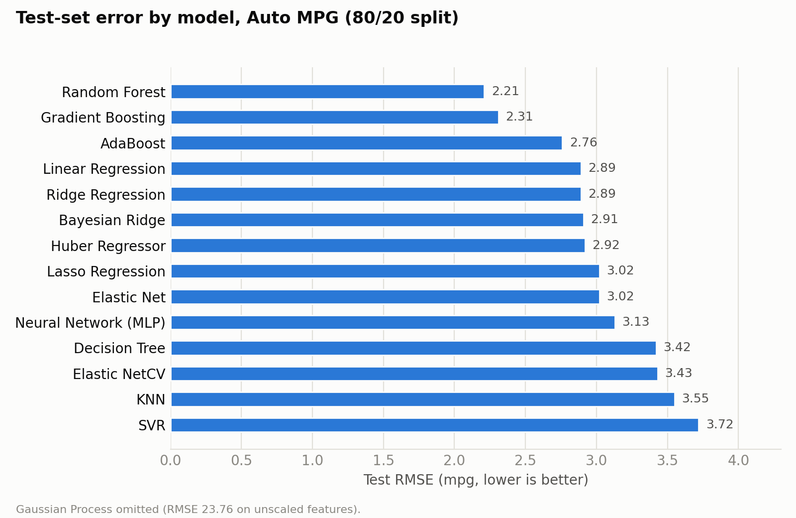
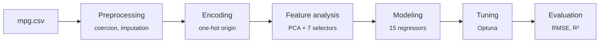

<div align="center">

# Auto-MPG

**How many miles per gallon will this car get?**

An end-to-end regression pipeline built on the CRISP-DM process. It cleans the UCI Auto MPG data, compares imputation and feature-selection methods, trains 15 regressors, tunes the best one with Optuna, and reports held-out error.


[Quick start](#quick-start) · [Results](#results) · [Limitations](#limitations)

</div>



## Contents

- [What it does](#what-it-does)
- [See it work](#see-it-work)
- [Results](#results)
- [How the pipeline works](#how-the-pipeline-works)
- [Quick start](#quick-start)
- [Project structure](#project-structure)
- [Limitations](#limitations)
- [Data credits](#data-credits)

## What it does

Given a car's cylinders, displacement, horsepower, weight, acceleration, model year and origin, the pipeline predicts its fuel efficiency in miles per gallon.

1. **Prepare.** Converts the `?` placeholders in `horsepower` to missing values and compares mean, median, most-frequent and constant imputation.
2. **Encode.** One-hot encodes `origin` (USA, Europe, Japan).
3. **Explore features.** Runs PCA and seven feature-selection methods: variance threshold, SelectKBest, mutual information, L1 regularization, recursive feature elimination, tree-based importance and sequential selection.
4. **Model.** Trains 15 regressors on an 80/20 split (`random_state=42`) and saves each one to `trained_models/`.
5. **Tune and evaluate.** Optuna searches the best model's hyperparameters, and every model is scored on the held-out set by RMSE and R².

## See it work

Predictions from the tuned Random Forest on cars from the held-out test set:

| Car | Cylinders | Horsepower | Weight (lb) | Year | Actual mpg | Predicted mpg | Error |
| --- | --- | --- | --- | --- | --- | --- | --- |
| Honda Civic | 4 | 53 | 1,795 | 1976 | 33.0 | 30.5 | -2.5 |
| Ford Ranger | 4 | 79 | 2,625 | 1982 | 28.0 | 29.5 | +1.5 |
| AMC Gremlin | 6 | 100 | 2,634 | 1971 | 19.0 | 20.5 | +1.5 |
| Plymouth Volare Premier V8 | 8 | 150 | 3,940 | 1976 | 13.0 | 14.9 | +1.9 |
| Plymouth Fury Gran Sedan | 8 | 150 | 4,237 | 1973 | 14.0 | 14.2 | +0.2 |
| Toyota Corolla 1600 (SW) | 4 | 88 | 2,100 | 1972 | 27.0 | 25.9 | -1.1 |
| Chrysler New Yorker Brougham | 8 | 215 | 4,735 | 1973 | 13.0 | 11.8 | -1.2 |

## Results

398 cars, 80/20 split. Held-out test set:

| Model | RMSE (mpg) | R² |
| --- | --- | --- |
| **Random Forest** | **2.21** | **0.910** |
| Gradient Boosting | 2.31 | 0.901 |
| AdaBoost | 2.76 | 0.859 |
| Linear Regression | 2.89 | 0.845 |
| Ridge Regression | 2.89 | 0.845 |
| Bayesian Ridge | 2.91 | 0.843 |
| Huber Regressor | 2.92 | 0.841 |
| Lasso Regression | 3.02 | 0.831 |
| Elastic Net | 3.02 | 0.830 |
| Neural Network (MLP) | 3.13 | 0.817 |
| Decision Tree | 3.42 | 0.782 |
| Elastic NetCV | 3.43 | 0.782 |
| KNN | 3.55 | 0.766 |
| SVR | 3.72 | 0.743 |
| Gaussian Process | 23.76 | -9.499 |

- **Tree ensembles win.** Random Forest and Gradient Boosting beat every linear model, which fits the non-linear relationship between weight, displacement and MPG.
- **After Optuna tuning**, Random Forest is still the best model (R² 0.909).
- **Scale-sensitive models struggle.** SVR, KNN and the Gaussian Process run on unscaled features. The Gaussian Process fails outright.

## How the pipeline works



- **Seven predictors, chosen explicitly.** `processed_data.csv` keeps every imputation strategy side by side, including imputed copies of the target (`mean_imputed_mpg` and others). The modeling scripts select the seven original predictors by name so no version of the label leaks into the features.
- **One split for every model.** All models share the same 80/20 split and seed, so their scores are directly comparable.
- **Models are saved** as joblib files in `trained_models/` and reloaded for evaluation.

## Quick start

Needs **Python 3.9+** and **git**.

```bash
git clone https://github.com/Akshayaamahesh/Auto-MPG-Detection.git
cd Auto-MPG-Detection
python3 -m venv venv && source venv/bin/activate
pip install -r requirements.txt

python main.py                                # load and preprocess the raw data
python src/Modeling/modeling.py               # train all regressors into trained_models/
python src/Modeling/evaluation.py             # score every model on the test set
python src/Modeling/hyperparameter_tuning.py  # Optuna tuning of the best model
```

## Project structure

```
├── Data/
│   ├── mpg.csv                   # Raw UCI Auto MPG data
│   └── processed_data.csv        # Output of the preprocessing stage
├── src/
│   ├── data_processing/          # Loading and cleaning
│   ├── hot_code_Encoding/        # One-hot encoding and distribution plots
│   ├── Dimensionality_reduction/ # PCA module, notebook, plots
│   ├── visualization/            # EDA and the seven feature-selection methods
│   └── Modeling/                 # Training, evaluation, hyperparameter tuning
├── trained_models/               # Saved regressors (joblib)
├── docs/images/                  # README figures
└── main.py                       # Pipeline entry point
```

## Limitations

<details>
<summary>Show all limitations</summary>

- **Small dataset.** 398 cars from 1970 to 1982, so the test set is about 80 cars and the scores have wide uncertainty.
- **Single split.** Results come from one 80/20 split. Cross-validation would give more reliable rankings.
- **No feature scaling.** SVR, KNN, MLP and the Gaussian Process would likely improve with standardized inputs.
- **Old cars only.** Predictions do not apply to modern vehicles, hybrids or EVs.
- **Gradient boosting libraries.** XGBoost, LightGBM and CatBoost are commented out in the code, so they are not part of the results.

</details>

## Data credits

- [Auto MPG](https://archive.ics.uci.edu/dataset/9/auto+mpg), UCI Machine Learning Repository (Quinlan, 1993).
- Libraries: scikit-learn, pandas, NumPy, Optuna, Matplotlib, seaborn.
