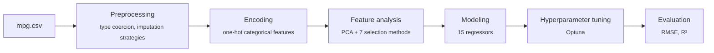

# Auto-MPG Fuel-Efficiency Prediction


An end-to-end regression pipeline that predicts a car's fuel efficiency (miles per gallon) from its engine and
body characteristics, structured around the **CRISP-DM** process: data understanding → preparation → modeling →
evaluation. The codebase is split into modular, independently testable stages.

## Results

15 regressors were trained on the [UCI Auto MPG](https://archive.ics.uci.edu/dataset/9/auto+mpg) dataset
(398 cars) with an 80/20 split (`random_state=42`). Top performers on the held-out test set:

| Model | RMSE (mpg) | R² |
|---|---|---|
| **Random Forest** | **2.21** | **0.910** |
| Gradient Boosting | 2.31 | 0.901 |
| AdaBoost | 2.76 | 0.859 |
| Linear Regression | 2.89 | 0.845 |
| Ridge Regression | 2.89 | 0.845 |
| Bayesian Ridge | 2.91 | 0.843 |

<sub>Run `python src/Modeling/evaluation.py` for the full table of all 15 models. Tree ensembles outperform linear
models, which is consistent with the non-linear relationship between weight / displacement and MPG.</sub>

## Pipeline



- **Data preparation** — handles the `?` placeholders in `horsepower`, compares mean / median / mode / constant imputation, and one-hot encodes `origin`.
- **Dimensionality reduction** — PCA with cumulative explained-variance analysis and 2-D projections.
- **Feature selection** — variance threshold, SelectKBest, mutual information, L1 regularization, recursive feature elimination, tree-based importance, and sequential feature selection.
- **Modeling** — linear (OLS, Ridge, Lasso, Elastic Net, Bayesian Ridge, Huber), tree ensembles (RF, Gradient Boosting, AdaBoost), kernel / instance-based (SVR, k-NN, Gaussian Process), and an MLP.
- **Tuning** — Optuna search over the best-performing model family.

## Quick Start

```bash
git clone https://github.com/Akshayaamahesh/Auto-MPG-Detection.git
cd Auto-MPG-Detection
python3 -m venv venv && source venv/bin/activate
pip install -r requirements.txt

python main.py                               # load + preprocess raw data
python src/Modeling/modeling.py              # train all regressors → trained_models/
python src/Modeling/evaluation.py            # evaluate on the held-out test set
python src/Modeling/hyperparameter_tuning.py # Optuna tuning of the best model
```

## Project Structure

```
├── Data/
│   ├── mpg.csv                  # Raw UCI Auto MPG data
│   └── processed_data.csv       # Output of the preprocessing stage
├── src/
│   ├── data_processing/         # Loading and cleaning
│   ├── hot_code_Encoding/       # One-hot encoding + distribution plots
│   ├── Dimensionality_reduction/# PCA module, notebook, plots
│   ├── visualization/           # EDA and 7 feature-selection methods
│   └── Modeling/                # Training, evaluation, hyperparameter tuning
├── trained_models/              # Serialized (joblib) regressors
└── main.py                      # Pipeline entry point
```

## Methodology Note

`processed_data.csv` keeps the outputs of each imputation strategy side by side for comparison, which
includes imputed copies of the target (`mean_imputed_mpg`, ...). The modeling scripts therefore select the seven
original predictors explicitly, so that no version of the label leaks into the features.
